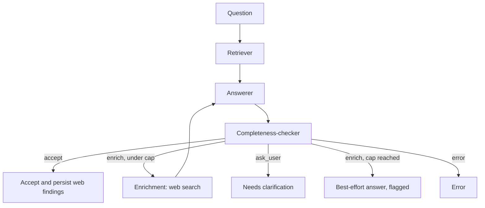

# Lacuna

A self-correcting RAG knowledge base. Upload documents, ask questions in
plain language, and the system checks whether what it retrieved actually
answers the question. When it doesn't, it searches the web for the
specific missing piece, answers again, and, once the answer holds up,
saves what it found so the same gap doesn't need re-searching.

*Lacuna* means "a gap". The project is about noticing one.

## The problem

A standard RAG system retrieves the closest chunks it can find and
answers from them, even when those chunks don't cover the question. The
model fills the gap with plausible text. Lacuna treats "did I retrieve
something relevant?" and "is what I retrieved *sufficient*?" as two
separate questions and handles the second one explicitly.

## Architecture



Built as a LangGraph state machine. The `Enrichment -> Answerer` edge is
a real cycle, bounded by `MAX_ENRICHMENT_ITERATIONS`.

| Piece | File | Role |
|---|---|---|
| Ingestion | `src/ingest.py` | Load, chunk, embed (`fastembed`, local), store in Chroma |
| Answerer | `src/rag.py` | Answer from retrieved context as a validated Pydantic object |
| Completeness-checker | `src/completeness.py` | Independent critic call that decides accept / enrich / ask_user |
| Enrichment tool | `src/websearch.py` | DuckDuckGo search (no API key) and persistence of useful results |
| Orchestration | `src/graph.py` | The LangGraph state machine and routing |
| Service | `src/api.py` | FastAPI: `/upload`, `/query`, `/feedback`, `/health` |
| Tracing | `src/tracing.py` | Optional Langfuse tracing, a strict no-op when unconfigured |
| Evaluation | `eval/` | Hand-labeled benchmark and scoring harness |

## Key design decisions

**The critic is a separate LLM call and never sees the Answerer's own
confidence score.** A model asked to both answer and grade itself tends
to rate fluent output as trustworthy. The critic sees only the question,
the context, and the answer text, and has to judge sufficiency
independently.

**Structured output everywhere, with one shared retry path.** Every LLM
call goes through `llm.invoke_structured`, which binds a Pydantic schema
and retries a bounded number of times on validation failure. That is one
mechanism, not one per node.

**The loop returns to the Answerer, not the Retriever.** Re-running a
vector search with the same question returns the same chunks. Only the
context changes between rounds (web results are appended), so only the
Answerer and the critic need to re-run.

**The iteration cap lives in the routing function.** It decides whether
to loop at all, so it belongs at the decision point and not inside the
node that runs after the decision is made. It is unit-tested in
isolation.

**Source attribution without filename hallucination.** The LLM picks
numeric `[Source N]` labels. Plain Python maps them back to filenames
(`rag.resolve_sources`), so the model never has to reproduce a string
exactly.

**Optional integrations degrade to no-ops.** A missing API key, a failed
search, or an unconfigured Langfuse never crashes the pipeline. Each
produces a clean `error` status or silently does nothing.

**Persistence only on success.** Web findings are written back to the
knowledge base only when an answer is *accepted*. Search results that
didn't lead to a confident answer aren't worth keeping.

**Eval runs disable persistence** (`persist_enrichment=False`).
Otherwise a previous run's auto-ingested content would change what later
runs retrieve, and results would drift between runs.

## Evaluation

```bash
python eval/run_eval.py --persist ./chroma_db --output results.json
```

A 14-question hand-labeled benchmark in three categories:

- **answerable**: the documents cover it. Expected outcome: accepted.
- **unanswerable**: no document and no web search can answer it. Expected
  outcome: *not* accepted.
- **ambiguous**: the question is underspecified. Expected outcome:
  `ask_user`.

The headline metric is the **false-negative rate**: how often an
unanswerable question was still accepted. That is the failure mode that
produces a fabricated answer a user might trust. Overall accuracy is
reported too, but it can hide this.

`score()` is a pure function, so the scoring logic is unit-tested without
an LLM (`tests/test_eval.py`). An optional RAGAS integration
(`eval/ragas_eval.py`) adds faithfulness and relevancy scores on the
answerable subset.

### Results

> Not yet recorded. Run the command above against a configured model and
> fill this table in.

| Metric | Value |
|---|---|
| Routing accuracy | _tbd_ |
| False-negative rate | _tbd_ |
| Model / provider | _tbd_ |
| Date | _tbd_ |

## API

| Endpoint | Purpose |
|---|---|
| `GET /health` | Liveness check |
| `POST /upload` | Multipart upload (`.txt`, `.md`, `.pdf`); searchable immediately |
| `POST /query` | `{"question": "..."}` returns the structured result and verdict |
| `POST /feedback` | Thumbs up/down on an answer, appended to `data/feedback.jsonl` |

Interactive docs are at `/docs` when the service is running.

## Setup

```bash
python3 -m venv venv
source venv/bin/activate        # Windows: venv\Scripts\activate
pip install -r requirements.txt
cp .env.example .env            # then add your GROQ_API_KEY
```

A free Groq key is available at https://console.groq.com. Gemini works
as a drop-in alternative (`LLM_PROVIDER=gemini`).

```bash
python scripts/build_index.py --docs data/sample_docs --persist ./chroma_db
python scripts/ask_graph.py "What is the refund policy for monthly plans?"
uvicorn src.api:app --reload            # or: docker compose up --build
pytest tests/                           # no API key or network needed
```

## Deployment

The `Dockerfile` runs the service with `uvicorn`. `render.yaml` is a
Render blueprint with a health check and a persistent disk for the
vector store (a persistent disk needs a paid Render instance; on the
free tier the index resets on restart). Any Docker host works. Set
`GROQ_API_KEY` as an environment variable on the host and never commit
it. CI (`.github/workflows/tests.yml`) runs the full test suite on every
push with no secrets configured, because the suite is entirely offline.

## Limitations

- **The benchmark can't show enrichment helping.** The sample documents
  describe a fictional product, so a real web search can't find
  anything useful about it. The benchmark therefore measures whether the
  system *refuses to fabricate*, not whether enrichment *improves*
  answers. Showing the latter needs a document set about real, searchable
  subject matter.
- **Small benchmark.** 14 questions is enough to catch a broken
  design, not enough for tight confidence intervals.
- **No deduplication of auto-ingested content.** Accepting several
  answers on the same topic can add near-duplicate web chunks to the
  store. There is no quality filter or de-dup step yet.
- **Web sources aren't merged into `sources`.** Document citations are
  resolved to filenames. Web results are returned separately in
  `web_sources`.
- **Trace grouping.** With Langfuse enabled, each LLM call is its own
  top-level trace instead of one trace per user question.
- **Feedback is logged, not used.** `/feedback` records ratings. Nothing
  re-weights retrieval or flags documents from them yet.
- **Search relies on an unofficial scraper library.**
  `duckduckgo-search` can be rate-limited. The enrichment node handles
  failures gracefully, but a production system would want an official
  search API.

## Roadmap

- [x] Basic RAG pipeline (ingestion, embeddings, retrieval)
- [x] Structured output and retry-on-validation-failure
- [x] LangGraph state machine with an independent completeness critic
- [x] Enrichment loop with a hard iteration cap
- [x] FastAPI service and Docker
- [x] Tracing and an evaluation harness
- [x] Persistent enrichment, feedback endpoint, CI, deployment config
- [ ] Record real evaluation results
- [ ] Evaluate on a real-world document set where enrichment can help
- [ ] Deduplicate and quality-filter auto-ingested content

## License

MIT
