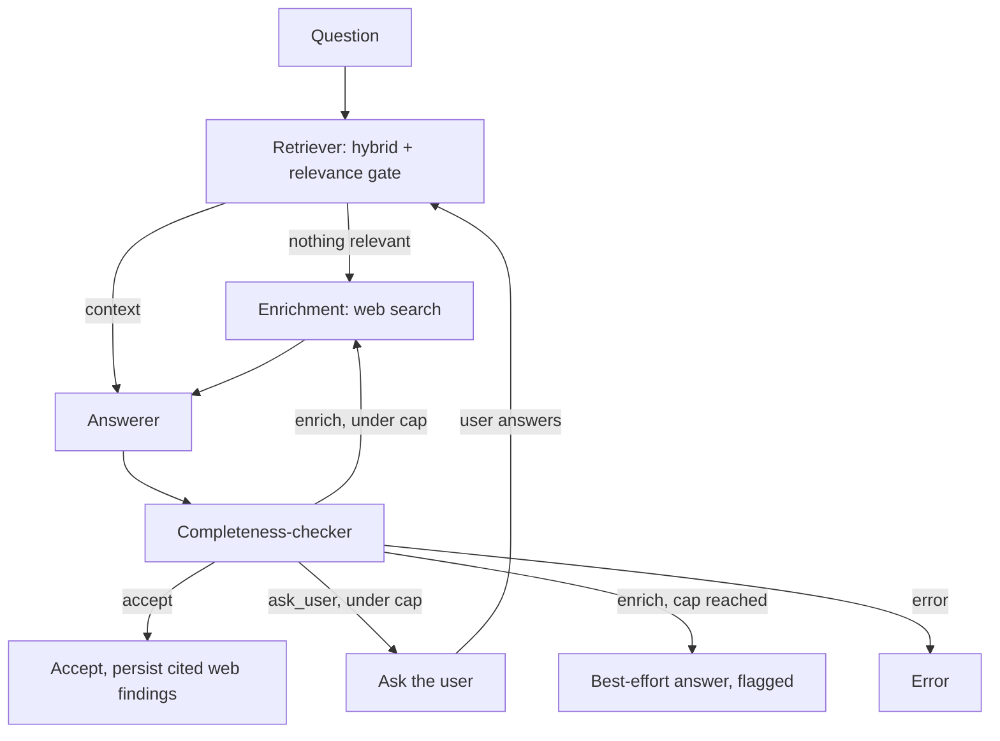

# Lacuna

A self-correcting RAG knowledge base. Upload documents, ask questions in
plain language, and the system checks whether what it retrieved actually
answers the question. When it doesn't, it searches the web for the
specific missing piece, answers again, and, once the answer holds up,
saves what it found so the same gap doesn't need re-searching.

*Lacuna* means "a gap". The project is about noticing one.

## The problem

A standard RAG system retrieves the closest chunks it can find and
answers from them, even when those chunks don't cover the question. The
model fills the gap with plausible text. Lacuna treats three questions
as separate and handles each one explicitly:

1. **Did I retrieve anything relevant?** A vector store always returns
   its *k* nearest neighbours, however far away they are. Lacuna gates
   retrieval on relevance, so an off-topic question retrieves nothing
   rather than four unrelated chunks that make the context look full.
2. **Is what I retrieved *sufficient*?** An independent critic call
   judges the answer against the context it was built from.
3. **Can the gap be closed?** If the missing piece is specific and
   nameable, a web search goes after exactly that, bounded by a hard
   iteration cap.

## Architecture



Built as a LangGraph state machine. The `Enrichment -> Answerer` edge is
a real cycle, bounded by `MAX_ENRICHMENT_ITERATIONS`.

| Piece | File | Role |
|---|---|---|
| Ingestion | `src/ingest.py` | Load `.txt`/`.md`/`.pdf`, chunk, store in Chroma |
| Embeddings | `src/embeddings.py` | Local ONNX embeddings via `fastembed`, no API key |
| Retrieval | `src/retrieval.py` | Dense + BM25 fused with RRF, then a relevance gate |
| Reranking | `src/rerank.py` | Local cross-encoder; off by default, see Evaluation |
| Answerer | `src/rag.py` | Answer from numbered sources as a validated Pydantic object |
| Completeness-checker | `src/completeness.py` | Independent critic: accept / enrich / ask_user |
| Enrichment tool | `src/websearch.py` | DuckDuckGo search (no API key), dedup, persistence rules |
| Orchestration | `src/graph.py` | The LangGraph state machine and routing |
| Service | `src/api.py` | FastAPI: `/upload`, `/query`, `/feedback`, `/stats`, `/health` |
| Tracing | `src/tracing.py` | Optional Langfuse tracing, a strict no-op when unconfigured |
| Evaluation | `eval/` | Hand-labelled benchmarks and scoring harnesses |

## Key design decisions

**The critic is a separate LLM call and never sees the Answerer's own
confidence score.** A model asked to both answer and grade itself tends
to rate fluent output as trustworthy. The critic sees only the question,
the context, and the answer text, and has to judge sufficiency
independently.

**Retrieval is hybrid, because dense search and lexical search fail
differently.** An embedding model is good at "what happens if a payment
fails" matching "failed payments result in a grace period". The same
property makes it weak on rare literal tokens — `FIDO2`, `429`,
`X-RateLimit-Reset`, a plan name — which are exactly what a user quotes
when they want one specific fact. BM25 is the opposite. The two rankings
are combined with Reciprocal Rank Fusion rather than a weighted score,
because dense relevance and BM25 scores aren't on a common scale and
BM25's upper bound moves with the corpus; RRF only reads ranks, so there
is nothing to recalibrate when documents are added.

**`accept` has to mean two things at once, so it's checked as two.**
"This answer is well-supported by the context" and "this question has
been answered" are different claims, and they come apart precisely where
it matters most: an answer that says *"the context does not state who the
CTO is"* is maximally well-supported and resolves nothing. The critic
judges support, so it accepted those — and the caller received a refusal
labelled as a finished answer while the enrichment loop sat idle, because
the gap was never routed anywhere. The critic now reports
`answer_resolves_question` as a separate field, and a validator rejects
`accept` without it, which turns a refusal into an enrichment round. This
was invisible until the end-to-end benchmark was actually run; see
Evaluation.

**A clarification re-runs the pipeline; it does not resume a
checkpoint.** `ask_user` used to be a dead end — the critic would
correctly identify that a question was underspecified, name the
ambiguity, and stop, so the most interesting routing decision produced
the least useful outcome. It's now resumable, and the resume is a fresh
graph run carrying the clarification history rather than a restored
LangGraph checkpoint. That's deliberate: a clarification changes *which
documents are relevant*, so it invalidates everything the previous run
computed. Measured on the sample corpus, the ambiguous "What is the
price?" retrieves **nothing at all** — correctly, it's too vague to clear
the relevance floor — while "What is the price? the Team plan" retrieves
three chunks. There is no retrieval state worth preserving, and a
checkpointer would faithfully restore an empty result. Re-running is
simpler, more correct, and keeps the service stateless enough to sit
behind more than one replica.

Retrieval uses the user's *replies*, not the questions we asked them —
the replies are where the disambiguating terms are; our own wording only
adds lexical noise. The critic sees the exchange too, for the same
reason it sees the enrichment history: otherwise it asks the user to
disambiguate something they just disambiguated. And the loop is capped
(`MAX_CLARIFICATIONS`), because a critic that can ask for a
clarification can ask forever, and "still ambiguous" is not a reason to
keep a person answering questions.

**Retrieval can return nothing, and that's a feature.** A chunk survives
only if it has real evidence behind it: enough dense relevance, or
enough *lexical IDF coverage* — the share of the question's rare-term
weight that the chunk actually matched. The IDF measure matters because
every document shares stopwords with every question, so a
corpus-normalised BM25 score makes the best stopword match look like a
perfect one. Measured: that distinction is the difference between
rejecting 0% and 100% of off-topic questions.

**Empty retrieval skips straight to enrichment.** Asking a model to
answer from a knowingly-empty context and then asking a second model
whether that answer was supported costs two LLM calls to establish
something already known for certain.

**The loop returns to the Answerer, not the Retriever.** Re-running a
vector search with the same question returns the same chunks. Only the
context changes between rounds, so only the Answerer and the critic need
to re-run.

**The iteration cap lives in the routing function.** It decides whether
to loop at all, so it belongs at the decision point and not inside the
node that runs after the decision is made. It's unit-tested in isolation
*and* exercised end-to-end.

**Schema constraints do real work.** Every LLM call goes through
`llm.invoke_structured`, which binds a Pydantic schema and re-prompts on
validation failure *with the error attached* — so a constraint expressed
in the schema becomes a self-correcting behaviour. `gap_description` is
rejected when the critic says "enrich" without naming a gap, because an
enrich verdict with no gap leaves the search falling back to the raw
question: the search that already failed to help.

**The critic sees what has already been searched.** Without that it was
stateless across iterations and would re-request a search it had just
made, spending the iteration budget on a duplicate. The history is
framed as "don't repeat a query", never as "stop holding out for
evidence" — telling a model that searching has been unproductive is an
invitation to accept an unsupported answer, which is the exact failure
this project exists to prevent. Running out of budget is the
orchestrator's decision, not the critic's.

**Citations cover documents and web results in one numbering.** The
model only ever picks integers out of a small known range, so it can't
hallucinate a filename; plain Python maps them back. Provenance labels
*are* shown to it, so it can weigh a document against a web result and
is told to prefer the document when they conflict.

**Persistence is narrow on purpose, and narrower than it first was.**
Web findings are written back only when an answer is *accepted*, only
for results the answer actually *cited*, only for URLs not already
stored, and only when the answer **also cites at least one document**.
A search for one gap returns three results, typically one of which
contains the missing fact; persisting all three would add unvetted web
text to the knowledge base for every gap closed, where it then competes
with the user's own documents in every future retrieval.

The document-anchor rule was added after the unguarded version poisoned
the index during testing, in a way that fed on itself. The vague
question "What is the price?" was routed to enrichment, the search
returned Wikipedia and Merriam-Webster on the *concept* of price, the
critic accepted an answer built entirely from them, and all three were
written into the store. From then on that same question retrieved those
chunks, looked well-supported, and was accepted immediately without
enrichment — so the contamination made the bad answer *more* likely each
time rather than less. A document citation is the signal that a web
result was filling a gap in a corpus-grounded answer, which is the
designed case, rather than standing in for the corpus entirely. A
web-only answer may still be a good answer; it just isn't evidence about
the user's documents, so it doesn't earn a permanent place among them.

**Optional integrations degrade to no-ops.** A missing API key, a failed
search, or an unconfigured Langfuse never crashes the pipeline.

**Eval runs disable persistence** (`persist_enrichment=False`).
Otherwise a previous run's auto-ingested content would change what later
runs retrieve, and results would drift between runs.

## Evaluation

There are two harnesses, because they have very different costs.

### Retrieval (offline, no API key)

```bash
python eval/retrieval_eval.py --persist ./chroma_db
python eval/retrieval_eval.py --persist ./chroma_db --sweep   # tune MIN_RELEVANCE
```

25 hand-labelled questions (gold label = which source file answers it)
plus 6 off-topic distractors with no gold document, over the 28-chunk
sample corpus. The embedding model is local and the label is a filename,
so this needs no LLM and runs in CI.

Measured, `TOP_K=4`, `MIN_RELEVANCE=0.4`, `bge-small-en-v1.5`:

| Configuration | hit@k | MRR | precision | off-topic rejected |
|---|---|---|---|---|
| dense only (the original behaviour) | 100.0% | 0.973 | 47.0% | 0.0% |
| dense + relevance gate | 100.0% | 0.973 | 47.9% | 100.0% |
| **hybrid + relevance gate** (default) | **100.0%** | **1.000** | **56.2%** | **100.0%** |
| hybrid + cross-encoder rerank | 92.0% | 0.920 | 71.2% | 100.0% |

**The reranker lost, and is off by default.** That last row is the
measurement that stopped it shipping: it buys 15 points of precision and
pays 8 points of hit@k, which is the wrong direction for this system. A
chunk the gate drops means the corpus can no longer answer at all and
the question goes out to web search; thin precision just leaves padding
the critic already copes with. Concretely it returned *nothing* for
"which permission levels can I assign to a user?" against a document
whose section is headed "Roles" — a paraphrase the bi-encoders handle
and `ms-marco-MiniLM` scored below threshold. It also had no ordering
left to win, since fusion alone already scores MRR 1.000 here. The
implementation stays in `src/rerank.py` (`RERANK=true`) because the
reasoning for reranking still holds on a corpus where MRR isn't
saturated — but it needs re-measuring there rather than assumed.

Read these honestly. hit@k was already saturated — 28 chunks over 9
documents is a small corpus and dense retrieval finds the right file for
every question. What changes is *rank* (MRR 0.973 → 1.000: the first
chunk is now always a gold chunk), *precision* (47% → 56%: less padding
in the context), and the thing dense-only cannot do at all — refusing an
off-topic question instead of returning four irrelevant chunks. On a
larger corpus hit@k would have room to move and these numbers would be
more interesting; on this one, the distractor column is the real result.

`MIN_RELEVANCE=0.4` is where `--sweep` shows off-topic rejection
reaching 100% while hit@k is still 100%; it degrades past 0.45 as real
answers start getting gated out. That knee is corpus-dependent and the
default should be re-swept for a different document set.

### End-to-end routing (needs a configured provider)

```bash
python eval/run_eval.py --persist ./chroma_db --output results.json
```

A 14-question hand-labelled benchmark in three categories:

- **answerable**: the documents cover it. Expected outcome: accepted.
- **unanswerable**: no document and no web search can answer it. Expected
  outcome: *not* accepted.
- **ambiguous**: the question is underspecified. Expected outcome:
  `ask_user`.

The headline metric is the **false-negative rate**: how often an
unanswerable question was still accepted. That is the failure mode that
produces a fabricated answer a user might trust. Overall accuracy and a
per-category breakdown are reported too, but a single number hides which
category regressed.

A pipeline **error counts as incorrect in every category**, and the
error rate is reported alongside the accuracy. This had to be fixed
rather than designed: correctness for "unanswerable" was defined as
`final_status != "accepted"`, so a crashed run scored as having
correctly refused to fabricate — meaning a provider outage mid-run would
quietly *improve* the headline number. Two questions hit it on a real
run, which is the only reason it was noticed. A metric that credits its
own failures is worse than no metric.

`score()` is a pure function, so the scoring logic is unit-tested without
an LLM (`tests/test_eval.py`). An optional RAGAS integration
(`eval/ragas_eval.py`) adds faithfulness and relevancy scores on the
answerable subset.

14 questions, `gemini-3.5-flash-lite`, 2026-11-02. Three runs after the
fix are shown rather than one, because the variance between them is
itself a result — a single figure from the best run would be
cherry-picking:

| Metric | Before the `accept` fix | After (3 runs) |
|---|---|---|
| Routing accuracy | 50.0% | 78.6% / 85.7% / **92.9%** |
| **False-negative rate** | **100.0%** | **0.0% / 0.0% / 0.0%** |
| answerable | 6/6 | 6/6 / 6/6 / 6/6 |
| unanswerable | 0/5 | 4/5 / 5/5 / 5/5 |
| ambiguous | 1/3 | 1/3 / 1/3 / 2/3 |
| Pipeline errors | 0 | 2 / 0 / 0 |
| Enrichment rounds used | 2 | 13 / 14 / 13 |

What's stable and what isn't matters more than the headline. **The
false-negative rate is 0.0% in every run, and `answerable` is 6/6 in
every run** — those are the two claims the project rests on. The spread
in overall accuracy comes almost entirely from the ambiguous category
and from two transient pipeline errors in one run; the 4/5 on
unanswerable is one of those errors, not a fabrication. 14 questions on
one model is enough to show a 50%→85% shift is real and to find
structural bugs. It is not enough for a second decimal place.

Running this for the first time is what found the `accept` conflation
described under Key design decisions, and the "before" column is worth
keeping because of what it is *not*. A 100% false-negative rate reads
like catastrophic hallucination; the system was in fact refusing
correctly every time, at confidence 0.0, even correctly distinguishing
Aria Cloud Storage from the unrelated real-world "ARIA" organisations the
web search surfaced. Every component was right about the question it was
individually asked. What was broken was that a supported refusal
satisfied `accept`, so the user got a refusal presented as a finished
answer — and the 2-rounds-across-14-questions figure shows the headline
enrichment loop was almost entirely dormant as a direct result. Fixing
the conflation is what took enrichment to ~13 rounds and the
false-negative rate to zero.

Running this for the first time is what found the `accept` conflation
described under Key design decisions, and the "before" column is worth
keeping because of what it is *not*. A 100% false-negative rate reads
like catastrophic hallucination; the system was in fact refusing
correctly every time, at confidence 0.0, even correctly distinguishing
Aria Cloud Storage from the unrelated real-world "ARIA" organisations the
web search surfaced. Every component was right about the question it was
individually asked. What was broken was that a supported refusal
satisfied `accept`, so the user got a refusal presented as a finished
answer — and the 2-rounds-across-14-questions figure shows the headline
enrichment loop was almost entirely dormant as a direct result. Fixing
the conflation is what took enrichment to 14 rounds and the
false-negative rate to zero.

**The remaining weakness is ambiguity detection, and it is
non-deterministic.** It scored 1/3, 1/3 and 2/3 across the three runs,
and spot-checks of a single question ("What is the price?") have
variously produced `ask_user`, an enrichment round, and an outright
`accept`. "What happens if I cancel?" consistently gets `enrich` — it
spots the insufficiency but picks the wrong remedy, since no search can
tell it which plan you mean. This is the ceiling on the clarification
loop: the loop itself works, but the critic has to notice the ambiguity
before it can run.

Not patched, deliberately. Three labelled questions is a sample to
measure against, not to tune against, and leaning harder on `ask_user`
in the prompt would put the 6/6 answerable score at risk — trading a
reliable strength for an unreliable one. The fix is more labelled
ambiguous cases first, then a change measured against them.

## API

| Endpoint | Purpose |
|---|---|
| `GET /health` | Liveness check |
| `GET /stats` | Chunk counts, including how many arrived via enrichment |
| `POST /upload` | Multipart upload (`.txt`, `.md`, `.pdf`); searchable immediately |
| `POST /query` | `{"question": "..."}` returns the answer, verdict, citations, and enrichment log |
| `POST /clarify` | Answers an outstanding clarification request and resumes |
| `POST /feedback` | Thumbs up/down on an answer, appended to `data/feedback.jsonl` |

Interactive docs are at `/docs` when the service is running.

## Setup

```bash
python3 -m venv .venv
source .venv/bin/activate       # Windows: .venv\Scripts\activate
pip install -r requirements.txt
cp .env.example .env            # then add your GROQ_API_KEY
```

Python 3.11 or newer. A free Groq key is available at
https://console.groq.com. Gemini works as a drop-in alternative
(`LLM_PROVIDER=gemini`).

The virtualenv is **not** in the repository and should never be: it's
around 20,000 files and several hundred megabytes, and it's
machine-specific (a venv hardcodes absolute paths, so it can't be moved
or shared anyway). `requirements.txt` is the only thing needed to
rebuild it, and the three commands above are the whole procedure. Both
`.venv/` and `venv/` are gitignored. If the environment ever gets into a
confusing state, deleting it costs nothing:

```bash
rm -rf .venv && python3 -m venv .venv && .venv/bin/pip install -r requirements.txt
```

```bash
python scripts/build_index.py --docs data/sample_docs --persist ./chroma_db
python scripts/ask_graph.py "What is the refund policy for monthly plans?"
python scripts/ask_graph.py "Which release added FIDO2 support?" --show-retrieval

# Ambiguous questions prompt for a clarification and then continue.
# --clarify pre-supplies the answer, so a run can be scripted:
python scripts/ask_graph.py "What is the price?" --clarify "the Team plan, annual billing"
uvicorn src.api:app --reload            # or: docker compose up --build
pytest                                  # no API key or network needed
```

`requirements.txt` lists direct dependencies with compatible-release
pins, not a `pip freeze` of the whole tree. For a byte-reproducible
install, generate a lockfile (`pip freeze > requirements.lock`) and
install from that — a dependency spec and a lockfile are different
artifacts and shouldn't be the same file. `requirements-eval.txt` holds
the optional RAGAS extras, which the service itself never imports.

## Deployment

The `Dockerfile` runs the service with `uvicorn` as a non-root user, and
bakes the embedding model into the image so the first request doesn't pay
an 80MB download. `render.yaml` is a Render blueprint with a health check
and a persistent disk for the vector store (a persistent disk needs a
paid Render instance; on the free tier the index resets on restart). Any
Docker host works. Set `GROQ_API_KEY` as an environment variable on the
host and never commit it. CI (`.github/workflows/tests.yml`) runs the
full test suite on Python 3.11, 3.12 and 3.13 with no secrets
configured, because the suite is entirely offline.

## Limitations

- **Ambiguity detection is the weakest routing category**, at 1/3. See
  Evaluation. Not patched, because three labelled questions is a sample
  to measure against, not to tune against. Note this limits how often
  the clarification loop gets to run at all: the loop works, but the
  critic has to notice the ambiguity first.
- **Pending clarifications are held in-process.** The exchange itself is
  just a few strings, but the token that identifies it lives in a dict,
  so a second replica won't recognise it and a restart forgets it.
  Swapping that store for Redis is the change to make before scaling
  out, and it's a change of backing store only - `/query` also accepts
  the exchange inline, so a stateless client can skip tokens entirely.
- **The benchmark can't show enrichment *helping*.** The sample documents
  describe a fictional product, so a real web search can't find anything
  useful about it. The benchmark measures whether the system *refuses to
  fabricate*, not whether enrichment *improves* answers. Showing the
  latter needs a document set about real, searchable subject matter.
- **Small benchmarks.** 25 retrieval questions and 14 end-to-end
  questions over a 28-chunk corpus is enough to catch a broken design and
  to tune one threshold. It is not enough for tight confidence intervals,
  and `MIN_RELEVANCE` in particular is tuned on 6 distractors.
- **The relevance threshold is metric-dependent.** It's calibrated for
  Chroma's default L2 distance, where an off-topic query scores ~0.1-0.3.
  A collection created with cosine distance compresses that range upward
  and needs a higher threshold. The gate fails *open* on scores it can't
  interpret, so a misconfiguration degrades to unfiltered retrieval
  rather than to returning nothing.
- **Persistence dedupes by URL, not by content.** Two different URLs
  carrying the same text will both be stored. An embedding-similarity
  check would catch that; an exact URL match is cheaper and was the
  larger win.
- **Auto-ingested content is filtered, not quality-assessed.** The
  accepted/cited/document-anchored rules (see Key design decisions) all
  ask *how the result was used*, not whether it is any good. A web page
  that a corpus-grounded answer genuinely cites still enters the store
  unvetted. The failure mode is specifically nasty because it compounds:
  once a bad chunk is in, it gets retrieved, makes the next answer look
  supported, and earns its own reinforcement. Content-level scoring
  before write, and a way to review or revoke auto-ingested chunks, are
  both still missing.
- **Feedback is logged, not used.** `/feedback` records ratings. Nothing
  re-weights retrieval or flags documents from them yet.
- **Search relies on an unofficial scraper library.** `ddgs` can be
  rate-limited. The enrichment node handles failures gracefully (a failed
  search still advances the iteration count, so a broken search can't
  loop forever), but a production system would want an official search
  API.
- **BM25 is rebuilt in-process.** The lexical index is held in memory and
  rebuilt when the collection's id set changes, which is fine for one
  process and a corpus of this size. Several replicas would each hold
  their own copy, and a large corpus would want a real lexical index.
- **Live tracing is unverified.** `src/tracing.py` is written against the
  current Langfuse SDK and its configured branch is tested with an
  injected fake client, but nothing here has exported a span to a real
  Langfuse instance.

## Roadmap

- [x] Basic RAG pipeline (ingestion, embeddings, retrieval)
- [x] Structured output and retry-on-validation-failure
- [x] LangGraph state machine with an independent completeness critic
- [x] Enrichment loop with a hard iteration cap
- [x] FastAPI service and Docker
- [x] Tracing and an evaluation harness
- [x] Persistent enrichment, feedback endpoint, CI, deployment config
- [x] Hybrid retrieval and a relevance gate, with a measured benchmark
- [x] Unified document + web citations
- [x] Query dedup and cited-only persistence
- [x] Record end-to-end evaluation results against a real provider
- [x] Separate "well-supported" from "actually answered" in the critic
- [x] Cross-encoder reranking, measured and defaulted off on this corpus
- [x] Make `ask_user` resumable instead of a dead end
- [ ] Improve ambiguity detection on a larger labelled sample
- [ ] Move pending clarifications to a shared store for multi-replica
- [ ] Quality-score auto-ingested content, and make it reviewable
- [ ] Evaluate on a real-world document set where enrichment can help
- [ ] Use feedback to re-weight retrieval

## License

MIT
